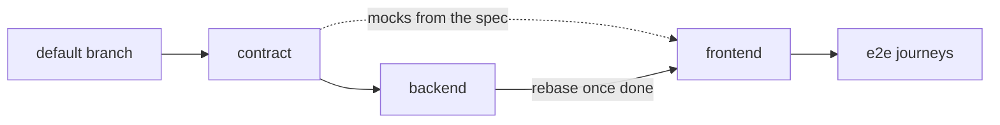

# Delegating full-stack work

How the main session hands a feature that spans an API and a UI to
sub-agents. This skill is orchestration only: what each side's code looks
like is the job of the convention skills that load from the files an agent
touches (`api-conventions`, `rest-conventions`, `frontend-conventions`,
`sql-conventions`, the language's skills). There is no backend or frontend
agent definition either: a "backend agent" is a general agent briefed on the
backend directory, and its conventions come with the files.

Every launch follows `CLAUDE.md`'s rules on delegation and sub-agent models;
the model hints below are where this flow usually lands, not a substitute for
weighing them. A feature is one topic under `CLAUDE.md`'s rule, which the
main session carries: its agents are `Agent` calls, inside herdr too, unless
the user asks for visible sessions. Nothing else in this flow depends on how
an agent is launched.

## One vertical slice by default

**A feature that touches both sides is built in one go, back and front, end
to end**, in one worktree, on one branch, as one PR — by the main session, or
by one agent when delegating pays under `CLAUDE.md`. It builds the endpoint,
then the screen against the real endpoint, and is the one place where the
whole feature is seen working.

Split only when the feature is big on both sides at once — several endpoints
*and* several screens or components — or when backend and frontend live in
separate repositories. A small feature (one endpoint, one screen) never
splits: it doubles the tokens and adds a coordination step for no gain, and
no agent ever sees the feature end to end.

## When it splits: the contract comes first

**Nothing runs in parallel until the API contract exists.** Two agents
guessing at the same payloads meet at integration with two different ideas of
it.

1. **The contract is its own change**, on its own branch and worktree, cut
   from the default branch: the backend's request and response DTOs and the
   routes declared with handlers that answer `501 Not Implemented`, per
   `api-conventions` and `rest-conventions`. The framework generates the
   OpenAPI document from that code, as `api-conventions` requires; nobody
   hand-writes a spec. The main session writes it, or an Opus agent: this is
   the judgement-heavy step, and every later agent builds on its mistakes.
2. **The user reviews the contract** before anything starts on top of it.
   Changing a field name now costs one edit; after the split it costs two
   agents and a rebase.
3. **Backend and frontend then run in parallel**, two agents, two worktrees,
   two branches, both cut from the contract branch:
   - the backend agent implements the handlers behind the declared routes;
   - the frontend agent generates its types and mocks from the contract's
     OpenAPI document (for instance `openapi-typescript` and MSW handlers)
     and builds the screens against them.

   Contract, backend and frontend are three changes, so three worktrees do
   not break "one worktree, one branch, one change", and "one agent per
   worktree" still holds: no checkout ever has two agents in it.
4. **The PRs stack as drafts**, per `pr-conventions`: the contract at the
   bottom, the backend on top of it, the frontend on top of the backend. Once
   the backend is done, the frontend rebases onto it and drops the mocks that
   the real API replaces. With separate repositories the frontend PR cannot
   stack on another repo's branch: it is based on its own default branch,
   links the backend PR in its description, and stays a draft until the
   backend ships.
5. **Merge the stack bottom-up with no release in between**: the contract on
   its own ships endpoints that answer 501.

## When it splits, the main session integrates

Beyond the contract, the main session writes no feature code. It briefs each
agent, relays the user's follow-ups, and checks that the pieces fit:

- **Every brief names the contract branch** and says the contract is fixed. An
  agent that needs it changed reports back instead of editing it.
- **A contract change goes through the contract branch**, then both sides
  rebase onto it: the main session makes the edit, or briefs the agent that
  owns the contract, and tells the other two.
- **Check the fit, not the code**: the frontend calls only routes the contract
  declares, with the payloads it declares, and the backend's generated
  document still matches the contract's. Review is `/code-review`, on each PR.

Implementation models are a judgement call per side: Sonnet fits a side that
is mostly applying the contract and known conventions, Opus a side with real
design left in it. When in doubt, Opus.

## The e2e agent

**One extra role is worth having when the work split**: an agent that runs
the integrated application and walks the user journeys, with Playwright for
instance. It covers the blind spot of a horizontal split — each side green
against the contract, and the feature still broken end to end.

- It starts once both sides have reported, in the frontend worktree rebased
  onto the backend branch, so the checkout holds the whole feature. The
  frontend agent is done by then: still one agent per checkout.
- Journey tests it writes land on the frontend branch, since they test what
  that PR adds.
- It reports failures; it does not fix them across the stack. The main
  session routes each one to the agent that owns that side, through
  `SendMessage`.
- Sonnet to run the journeys and report; Opus when the job becomes debugging
  a failure with no obvious cause.

A vertical slice runs those journeys itself: it has the whole feature
in one checkout.

## Roles not to create

- **Architect or product manager**: that is the main session and the user.
- **Documentation writer**: docs ship with the change they describe, under
  `CLAUDE.md`'s documentation rules, so each agent updates its own.
- **DevOps**: a chart, a Dockerfile or a CI change is a separate change with
  its own skills, not a role in this feature.
- **Database administrator**: migrations belong to the backend agent, which
  owns the schema the handlers read.
- **Reviewer**: `/code-review` on each PR covers it.
