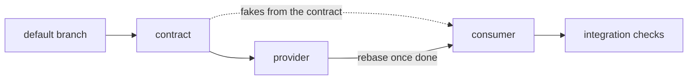

# Splitting a topic

`CLAUDE.md` decides which session carries a topic — the one it started in,
or a session of its own (`herdr-delegation`) — and splits it across agents
only when the pieces ship as separate PRs. This skill says how the carrying
session does that, whichever it is, for the
case that splits most often: work that spans two sides of an interface, a
**provider** that declares it and a **consumer** that calls it.

| Interface | Provider | Consumer | Contract |
|---|---|---|---|
| HTTP API | backend | web, CLI or mobile client | DTOs and routes answering `501`, OpenAPI generated from them |
| RPC or queue | service A | service B | the `.proto` or message schema |
| Kubernetes CRD | CRD and its schema | controller, or the charts that create it | the CRD's types and generated manifest |
| Library | the library | its consumers | the public types and signatures, bodies stubbed |

This skill is orchestration only: what each side's code looks like is the job
of the convention skills that load from the files an agent touches. There is
no provider or consumer agent definition either: a "backend agent" is a
general agent briefed on the backend directory, and its conventions come with
the files.

Every launch follows `CLAUDE.md`'s rules on delegation and sub-agent models;
the model hints below are where this flow usually lands, not a substitute for
weighing them. The pieces of one topic are not topics of their own: they are
`Agent` calls, inside herdr too, unless the user asks for visible sessions.

## One vertical slice by default

**Work that touches both sides is built in one go, provider and consumer,
end to end**, in one worktree, on one branch, as one PR — by the carrying
session, or by one agent when delegating pays under `CLAUDE.md`. It builds
the provider's side, then the consumer against the real thing, and is the
one place where the whole feature is seen working.

Split only when the work is big on both sides at once — several endpoints
*and* several screens, several messages *and* several handlers — or when the
two sides live in separate repositories. A small change (one endpoint, one
screen) never splits: it doubles the tokens and adds a coordination step for
no gain, and no agent ever sees the feature end to end.

## When it splits: the contract comes first

**Nothing runs in parallel until the contract exists.** Two agents guessing
at the same interface meet at integration with two different ideas of it.

1. **The contract is its own change**, on its own branch and worktree, cut
   from the default branch: the interface declared in code, with nothing
   behind it. For an HTTP API, the request and response DTOs and the routes
   declared with handlers that answer `501 Not Implemented`, per
   `api-conventions` and `rest-conventions`; the framework generates the
   OpenAPI document from that code, as `api-conventions` requires, and nobody
   hand-writes a spec. The carrying session writes it, or an Opus agent: this is
   the judgement-heavy step, and every later agent builds on its mistakes.
2. **The user reviews the contract** before anything starts on top of it.
   Changing a field name now costs one edit; after the split it costs two
   agents and a rebase.
3. **Provider and consumer then run in parallel**, two agents, two
   worktrees, two branches, both cut from the contract branch:
   - the provider agent implements what the contract declares;
   - the consumer agent generates its types and fakes from the contract —
     for an HTTP API, `openapi-typescript` and MSW handlers from the OpenAPI
     document, for instance — and builds against them.

   Contract, provider and consumer are three changes, so three worktrees do
   not break "one worktree, one branch, one change", and "one agent per
   worktree" still holds: no checkout ever has two agents in it.
4. **The PRs stack as drafts**, per `pr-conventions`: the contract at the
   bottom, the provider on top of it, the consumer on top of the provider.
   Once the provider is done, the consumer rebases onto it and drops the
   fakes the real thing replaces. With separate repositories the consumer PR
   cannot stack on another repo's branch: it is based on its own default
   branch, links the provider PR in its description, and stays a draft until
   the provider ships.
5. **Merge the stack bottom-up with no release in between**: the contract on
   its own ships an interface with nothing behind it.

## When it splits, the carrying session integrates

Beyond the contract, the carrying session writes no code for the topic. It
briefs each agent, relays the user's follow-ups, and checks that the pieces
fit:

- **Every brief names the contract branch** and says the contract is fixed.
  An agent that needs it changed reports back instead of editing it.
- **A contract change goes through the contract branch**, then both sides
  rebase onto it: the carrying session makes the edit, or briefs the agent that
  owns the contract, and tells the other two.
- **Check the fit, not the code**: the consumer calls only what the contract
  declares, the way it declares it, and the provider still matches the
  contract — for an HTTP API, its generated document still matches the
  contract's. Review is `/code-review`, on each PR.

Implementation models are a judgement call per side: Sonnet fits a side that
is mostly applying the contract and known conventions, Opus a side with real
design left in it. When in doubt, Opus.

## The integration agent

**One extra role is worth having when the work split**: an agent that runs
both sides together and walks the real flows — user journeys with Playwright
for a web client, a CLI against a running server, a controller against a
`kind` cluster. It covers the blind spot of a horizontal split: each side
green against the contract, and the feature still broken end to end.

- It starts once both sides have reported, in the consumer worktree rebased
  onto the provider branch, so the checkout holds the whole feature. The
  consumer agent is done by then: still one agent per checkout.
- Tests it writes land on the consumer branch, since they test what that PR
  adds.
- It reports failures; it does not fix them across the stack. The main
  session routes each one to the agent that owns that side, through
  `SendMessage`.
- Sonnet to run the flows and report; Opus when the job becomes debugging a
  failure with no obvious cause.

A vertical slice runs those flows itself: it has the whole feature in one
checkout.

## Roles not to create

- **Architect or product manager**: that is the carrying session and the user.
- **Documentation writer**: docs ship with the change they describe, under
  `CLAUDE.md`'s documentation rules, so each agent updates its own.
- **DevOps**: a chart, a Dockerfile or a CI change is a separate change with
  its own skills, not a role in this topic.
- **Database administrator**: migrations belong to the provider agent, which
  owns the schema its code reads.
- **Reviewer**: `/code-review` on each PR covers it.
